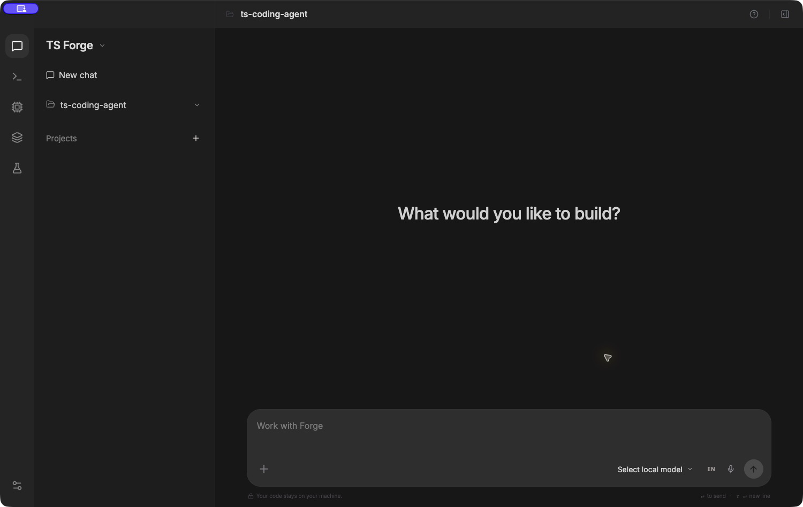

# TS Forge

**An open-source, local-first coding agent for TypeScript.**

Understand a project, build features, review changes, and run checks with a local model through Ollama.



## What it does

- **Understands your project:** maps files, symbols, imports, and framework relationships before working.
- **Plans and edits:** breaks down tasks, asks important questions, and proposes changes with reviewable diffs and undo.
- **Checks its work:** runs TypeScript and project validations, opens local previews, and inspects them with browser tools.
- **Keeps context:** saves sessions, decisions, checkpoints, and compacted history locally.
- **Supports your stack:** includes guidance for React, Next.js, React Native/Expo, Three.js/R3F, and Node.js backends.
- **Connects tools:** supports reviewed Git operations, optional web research, MCP connections, and SSH file delivery.

Built with Electron, React, TypeScript, and SQLite. No account or subscription required.

## Get started

Requires **macOS on Apple Silicon**, **Node.js 22.23.1**, and [Ollama](https://ollama.com/) with a locally installed model that supports tool calls.

```sh
git clone https://github.com/denyskozak/ts-forge.git
cd ts-forge
npm ci
npm run dev
```

1. Open **Settings**, choose your model, and click **Test connection**. The default Ollama endpoint is `http://127.0.0.1:11434`.
2. Open a project and let Forge analyze it.
3. Describe the change you want, answer any critical questions, and review proposed edits and execution requests.

## Privacy and safety

Model inference uses a loopback-only Ollama connection. Sessions and source context stay on your machine. File changes and privileged operations pass through review and validation gates.

Optional web research, package downloads, remote MCP servers, and SSH operations can use the network with approval. Local execution is not a complete security boundary; review generated code and tool requests. See [SECURITY.md](SECURITY.md).

## Development

```sh
npm test                 # Harness regression tests
npm run build            # Production build
npm run test:desktop     # Electron UI and IPC smoke tests
npm run eval:local       # Real Ollama coding evaluations
```

**Status: experimental.** Coding quality depends on the local model. A successful connection or TypeScript check does not prove that a feature works. Real-model evaluations still expose logic and recovery failures; signing and notarization remain unfinished.

## Learn more

- [Documentation](docs/README.md)
- [Evals and code quality](docs/evals-and-quality.md)
- [Contributing](CONTRIBUTING.md)
- [Security](SECURITY.md)

## License

[MIT](LICENSE). Model weights and datasets retain their own licenses.
